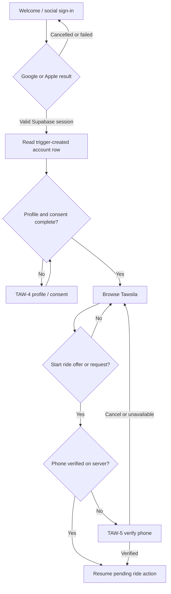

# Sign-up, onboarding and phone-verification flow (informative, cross-card)

Status: informative; **not** part of the TAW-7 spec gate and not authorization to implement TAW-4, TAW-5 or TAW-6. Source: the owner's draft v2.0 (2026-10-24), section 2A and section 7. Only stages A to C are built by TAW-7 (see `2026-10-21-TAW-7-design.md`); TAW-4 and TAW-5 own the rest and will specify their stages in their own cards, which need the owner's amendment approval first.

| Stage | Action | Owner |
|---|---|---|
| A, B, C | Welcome, provider authentication, account read | TAW-7 |
| D | Profile, age, Terms and Privacy; sets `profile_completed_at` through a trusted function | TAW-4 |
| E | Browsing; no phone OTP requested | TAW-4 and the app shell |
| F | Create ride offer or request; server checks `phone_verified` and other eligibility | TAW-5 and the ride feature |
| G | Verify mobile: WhatsApp-first OTP, controlled SMS fallback; the server confirms ownership | TAW-5 |
| H | Resume the same pending draft after revalidation and a fresh user confirmation | TAW-5 and the ride feature |

Requirements for the later cards (from the owner's draft): a delivery receipt is not proof of ownership, only a successful OTP validation changes `phone_verified`; an invalid, expired, replayed or rate-limited OTP keeps the phone unverified and the ride blocked; the pending ride draft is kept without OTPs or secrets and is never submitted without fresh confirmation and server checks; a completed OTP is bound to the current user and session; a phone already verified for another account is never assigned and never discloses the other account (a support or recovery path is TAW-5's decision); WhatsApp delivery uses the official Business API through a server-side Supabase Send SMS hook or bridge, with Meta delivery webhooks as status only; provider onboarding, template approval, Egypt rates, sender approval, fallback cost and abuse controls are prerequisites before enabling phone-gated ride functions in production.
