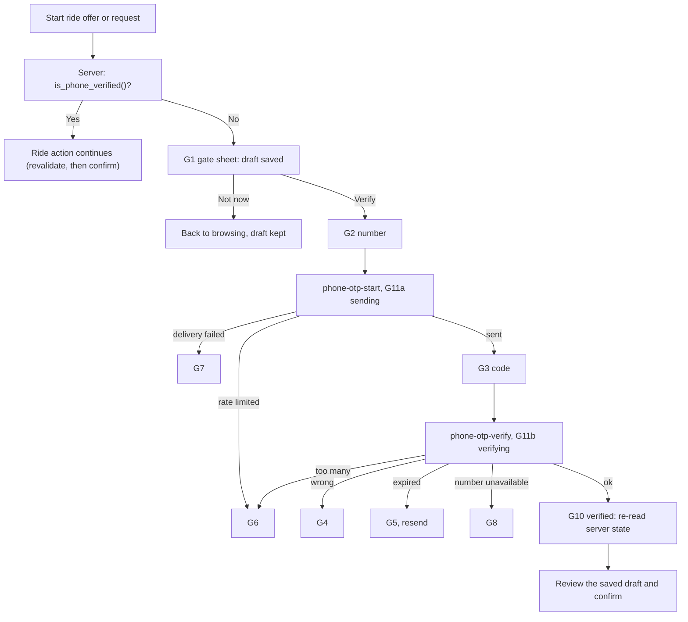

# TAW-5 Deferred phone verification: design spec (criteria revision 3, project-owned OTP)

Authoring card: TAW-5 authoring card (scope revision 1). Implementation card: TAW-5 (Critical lane), scope revision 3, AC1 to AC12. Author: Claude. Companion: `2026-10-26-TAW-5-provider-adr.md` (decision record, option B approved by the owner 2026-10-26, evidence quality, verification register). Approved design: Figma file `2j3vO1USLBA8XiRpQKCF3H`, section `214:1809` (design card DONE, 2026-10-26). Status: DRAFT for the spec gate (round 3); not approved; not authorization to implement.

Labels: **Fact** = verified in the repository or documented by the provider; **Reported** = relayed by the owner, not verified by the authoring session; **UNVERIFIED** = needs the verification register (section 11); **Proposal** = a recommendation that binds only after the owner approves it; **Approved** = approved by the owner in writing in this session.

## 1. Purpose, decisions and boundaries

A signed-in user (Google; Apple later) may browse, complete onboarding and profile, and select a community without a phone. Before the **first ride offer or first ride request, whichever comes first**, the user must verify a phone number with a WhatsApp one-time code. After a successful verification the user stays verified unless an owner-approved security rule requires re-verification (section 9).

Decisions (owner, 2026-10-24 to 2026-10-26): WhatsApp is the only channel; the SMS fallback is deferred (separate PROPOSED card); no phone or OTP at sign-up; Sign in with Apple later; **Approved (2026-10-26): option B, a project-owned OTP** (our Edge Functions and database own code generation, binding, expiry, attempts and verification; WhatsApp Cloud API with the template `tawsila_otp` only delivers); **Approved: 6-digit code**; Android stays BLOCKED; the Supabase Phone provider is not used by the app (sign-ups for it are switched Off, Reported). All other numeric limits remain Proposals (O2).

Boundaries (unchanged from TAW-7 and TAW-4):

| Owner | Responsibility |
|---|---|
| TAW-7 (DONE) | Sign-in, session storage, session-loss rules, the `accounts` row and its RLS |
| TAW-4 (DONE) | Profile, consent, car data, `can_request_rides()` and `can_post_rides()` (not changed here) |
| **TAW-5** | Phone verification, the server-side phone gate, draft resume, duplicate-phone handling, OTP abuse controls, the two Edge Functions and their database objects |
| Later cards | Logout, account deletion, SMS fallback, Android sign-in, Sign in with Apple, phone number change, the ride features themselves |

**Out of scope:** payments, fares, quotas; SMS delivery; phone number change (no UI exists; the server refuses to start a verification for an already verified account); sharing a phone number with another user (ride features); production WhatsApp onboarding steps (Egypt rates, sender approval); changing or deleting the existing `send-otp-hook` on the hosted project (it stays unused, O10).

## 2. Flow

1. The ride feature calls the client hook `usePhoneGate().requireVerified(pending)` before it starts a publish or a request. The hook reads `is_phone_verified()` from the server (never a local flag). If true it returns `proceed`.
2. If false it keeps a draft reference (section 7) and shows the gate sheet (G1a first offer, G1b first request). "Not now" returns to browsing with the draft kept.
3. Number entry (G2, default country EG +20, E.164 built on the client and validated again on the server) calls the Edge Function `phone-otp-start` with `{ phone, requestId }`. The number is not stored on the Supabase Auth user and not in the SDK session payload; the pending number exists only in component state and in the challenge row.
4. Code entry (G3) calls `phone-otp-verify` with `{ code }`. On success the app does not trust the call result: it re-reads `is_phone_verified()` and only then shows G10.
5. G10 returns to the draft reference. The action is **never submitted automatically**: the user reviews and confirms again ("Review and confirm"), after the app has re-checked profile completion and the TAW-4 eligibility (`can_post_rides()` or `can_request_rides()`) because time has passed.
6. A user who is already verified never sees the gate again (AC3).

Browse, onboarding, profile and community selection never call the gate (AC2).

**Binding of the code to the user and session (AC4, Approved reading: literal).** Both Edge Functions run with `verify_jwt = true` and additionally call `auth.getUser(accessToken)` so the Auth server confirms the session still exists; the user id is `sub` and the session is the `session_id` claim of the same token (**UNVERIFIED**, V2: claim present, stable across token refresh, `getUser` rejects a signed-out or revoked session). `start_phone_challenge` stores `user_id` and `session_id` with the challenge; `verify_phone_challenge` accepts a code only when both equal the caller's. A code issued for user A cannot verify for user B, and a code issued in one session cannot be used from another session of the same user (a new sign-in yields a new `session_id`; the user requests a new code). Unbound, mismatched, signed-out and unknown-challenge cases all return the same category `no_challenge` (non-disclosing). Tests: another user, no session, a signed-out session, a second session of the same user, an expired token, an expired challenge, a consumed challenge (replay).

## 3. Data model

No new columns on `accounts` (TAW-7 already has `phone_e164`, `phone_verified`, the check "verified requires a phone", the partial unique index on verified numbers, select-own RLS and no client write grants). **Fact** (migration 20261024204100).

New objects (one migration):

| Object | Purpose |
|---|---|
| `public.is_phone_verified()` | `stable security definer`, returns the caller's `accounts.phone_verified`; false when the row is missing; never raises; execute for `authenticated` |
| `public.require_phone_verified()` | raises `phone_unverified` (same `raise exception '<code>'` style as TAW-4) when not verified; for use inside ride RPCs and for tests; execute for `authenticated` |
| `public.phone_otp_challenges` | one row per code issued: `id`, `user_id`, `session_id`, `request_id` (unique with `user_id`), `phone_e164`, `phone_hash`, `code_hash`, `status` (lifecycle: `pending`, `sent`, `failed`, `consumed`, `locked`, `superseded`), `verify_outcome` (`verified` or `unavailable`, set only when `consumed`), `attempts`, `created_at`, `sent_at`, `expires_at`, `provider_message_id`; RLS enabled; no table privilege for any API role (access only through the functions below) |
| `public.start_phone_challenge(...)`, `public.finish_phone_challenge(...)`, `public.verify_phone_challenge(...)` | the whole protocol (sections 4 and 5); `security definer`, `search_path = ''`; execute for `service_role` only |
| `public.phone_verification_audit` | one row per change of `phone_verified`: `user_id`, `changed_at`, `old_verified`, `new_verified`, `cause` (`otp_confirmed`, `operator_revoke`), `challenge_id`, `session_id`; never stores the number; written only by `verify_phone_challenge` and `revoke_phone_verification`; no API role can read or write it |
| `public.purge_phone_challenges()` | deletes challenge and audit rows older than 30 days; owner-only, run by a scheduled database job (the job mechanism is chosen in the plan) |

Hashes: `code_hash = HMAC-SHA256(PHONE_HASH_PEPPER, user_id || ':' || code)` and `phone_hash = HMAC-SHA256(PHONE_HASH_PEPPER, 'phone:' || e164)`, both computed in the Edge Function; the pepper is an environment secret that the database never holds, so a database leak alone cannot brute-force a six-digit code. The database never sees the plaintext code.

Ride features must call `require_phone_verified()` inside their own security-definer RPCs, or use `is_phone_verified()` in RLS policies, **in addition to** TAW-4's `can_*` functions. TAW-5 does not change TAW-4's functions. Because no ride action exists yet (**Fact**, discovery 2026-10-26), TAW-5 proves the gate with a pgTAP-only fixture function that calls `require_phone_verified()`, and records the call-site rule for the ride cards.

## 4. Trusted setter (AC4, AC1, AC6, AC8)

`accounts.phone_verified` and `accounts.phone_e164` change only inside `verify_phone_challenge` (to verified) and `revoke_phone_verification` (to unverified, if the owner approves R1). There is **no trigger on `auth.users`** and nothing reads Supabase Auth phone state, so the Supabase Admin API (`phone_confirm`, `updateUser({ phone })`, the phone sign-in endpoint) cannot change `phone_verified`.

`verify_phone_challenge(user_id, session_id, code_hash)` runs in one transaction:

0. **Account lock and state recheck.** Take the per-account advisory lock (`pg_advisory_xact_lock` on the user id). **Lock order everywhere: project lock (start only), then account lock, then the challenge row.** `verify` and `revoke_phone_verification` never take the project lock, so there is no cycle. Under the account lock, if `accounts.phone_verified` is already true return `already_verified` and change nothing (the challenge is marked `superseded`).
1. Lock the user's newest `sent` challenge (`for update`). None, a different `session_id`, or a status other than `sent`: return `no_challenge`.
2. Expired (`now() >= expires_at`): return `expired`.
3. Wrong hash: `attempts += 1`; at 5 the challenge becomes `locked` (return `locked`), otherwise return `wrong`.
4. Correct hash: set `accounts.phone_e164` and `phone_verified = true` for `user_id`, mark the challenge `consumed` with `verify_outcome = 'verified'`, write the audit row (`otp_confirmed`), return `ok`.
5. If the update violates the partial unique index (the number is already verified by another account), the function catches it, marks the challenge `consumed` with `verify_outcome = 'unavailable'`, leaves `accounts` unchanged and returns `unavailable`. A violation of the E.164 check on `accounts` is handled the same way; it cannot occur for numbers accepted by `phone-otp-start`, which use the identical expression (section 5). The caller sees G8 with no field naming the other account. Two concurrent verifications of the same number are serialized by the index: exactly one commits.

`start_phone_challenge` takes the project lock, then the per-account lock, and refuses (`already_verified`) when the caller is verified **as read under that lock**; since `verify_phone_challenge` holds the same account lock while it assigns the number, a start can never interleave with a verification and issue a challenge for an account that has just become verified, so the first verified number is never replaced (interleaving test, section 10); there is no change-number capability (AC8). It does **not** check whether the number belongs to another account (otherwise the start step would reveal which numbers are registered); a collision surfaces only at step 5, after the requester has proven control of the number.

**Residual trust boundary (Proposal, owner to accept, O9).** The service-role key is the trust root of server code on Supabase, exactly as it is for any provider integration: a holder can call `start_phone_challenge` with a hash of a code they chose and then verify it. The key never reaches the app, the repository or logs (secrets scan in the gates); the holder cannot touch `accounts` directly (service-role privileges revoked, below); every verification writes an audit row with the challenge id, session id and provider message id (`provider_message_id` is recorded by `finish_phone_challenge`, and `verify_phone_challenge` only accepts challenges in status `sent`). This cannot be removed on Supabase and is documented rather than hidden.

**Direct writes to `accounts`.** The existing TAW-7 migration revokes write privileges from `public`, `anon` and `authenticated` only; it does not mention `service_role`, and the TAW-4 repair covers only profile and verification tables (**Fact**, read 2026-10-26). **New required TAW-5 work:** `revoke all on public.accounts from service_role` and `grant select` back, with denial tests for insert, update, delete and truncate as `service_role` (including forged claims) and a mutation check (section 15).

## 5. The Edge Functions (AC5, AC9, AC11)

Two functions under `supabase/functions/`, both `verify_jwt = true` in `supabase/config.toml`, both returning only fixed category codes (never the number, code or token).

**`phone-otp-start`** (input `{ phone, requestId }`):

1. Authenticate (section 2); validate the number with the **same expression as the existing `accounts_phone_e164_check`** (`^\+(?=[1-9])[0-9]{8,15}$`, 8 to 15 digits in total; a shared constant is asserted equal to the constraint definition by a pgTAP test); reject anything else with `invalid_phone` before any message is spent.
2. Generate the 6-digit code from a CSPRNG with rejection sampling (uniform), compute both hashes.
3. Call `start_phone_challenge(user_id, session_id, request_id, phone_e164, phone_hash, code_hash)`. In **one transaction** it takes the single project-wide advisory lock (all starts are serialized; acceptable at MVP scale, revisit at load), then the per-account lock (section 4 order), then:
   - **Same `(user_id, request_id)` already exists** (idempotent retry, outcome-aware, never sends again): if `session_id` or `phone_hash` differ it returns `request_conflict`; otherwise it answers by the stored row: the answer is `phone_request_response(row)` of section 5.1 (the only definition). A fresh Resend always uses a new request id; `request_conflict` is treated as the generic failure (G7).
   - **New request:** refuse with `already_verified` when the account is verified; count challenges in the window (failed ones included) for the user, the phone hash and the whole project; enforce the resend interval; supersede the user's older open challenges (`pending` or `sent`); insert a `pending` row with `expires_at`; return `ok`, or `rate_limited` (with `retry_after_seconds`).
4. On `ok` call the WhatsApp Cloud API (template `tawsila_otp`, OTP button parameter) with a **provider timeout of 10 seconds** (Proposal) and then `finish_phone_challenge(challenge_id, user_id, session_id, outcome, provider_message_id)`. `finish` is a conditional transition: it applies a transition only when the row matches `challenge_id`, `user_id` and `session_id` **and is still `pending`** (`applied`); an identical repeat of an already recorded completion returns `already_recorded` with the current lifecycle state; every other case (mismatched identifier, a different outcome than the recorded one, a row that never reached the requested outcome) returns `stale`; neither `already_recorded` nor `stale` changes the row. These checks protect ordinary calls against bugs, races and late completions; they are distinct from the accepted service-key trust boundary (section 4), which they do not claim to defend against. Delivery uncertainty is handled so a code the user cannot use is never presented as valid:
   - provider rejection, timeout or a lost response (acceptance unknown): `finish(..., 'failed')`, return `delivery_failed`; the row counts toward the limits; if the provider did deliver, that code is dead (a `failed` challenge cannot be verified) and the user requests a new one;
   - **`finish` is idempotent and outcome-aware.** It returns `applied` (the row matched and was `pending`), `already_recorded` (the row matches `challenge_id`, `user_id` and `session_id` and already records the same outcome: status `failed`, or `sent_at` set with the same `provider_message_id`, even if the row has since moved to `consumed`, `locked`, `superseded` or expired; the later lifecycle state is returned and never changed) or `stale` (a different recorded outcome, a mismatched identifier, or a row that never reached the requested outcome). `finish` always returns the row's current lifecycle state with its result, and the function maps `applied` and `already_recorded` through `phone_request_response(row)` of section 5.1, the same function the same-request path uses. A lost response can therefore never produce `sent` for an unusable code. Because a commit whose response was lost is indistinguishable from a failure, the function never concludes that the code is unusable from a failed call alone: provider accepted but `finish` errors or its response is lost: retry `finish` up to 3 times with short backoff (identical retries are safe); if the commit status is still unknown, return `in_progress` (not `delivery_failed`) so the client re-sends the same `requestId`, which reads the **authoritative stored state** (the answer is `phone_request_response(row)` of section 5.1). A code is presented as unusable only when the stored state says so;
   - `finish` returns `stale` (a different recorded outcome, for example a late completion after supersession or stale recovery closed the row as `failed`): return `delivery_failed` for the unusable code, change nothing;
   - crash before sending: the row stays `pending` and the stale rule closes it; the retry with the same request id returns `delivery_failed` after 2 minutes, or the user starts a new request;
   - database or limiter unavailable before the provider call: **fail closed**, `delivery_failed`, nothing sent. (A failure after provider acceptance cannot un-send; the table above is the contract for it.)
   - `in_progress` handling in the client: re-send the same `requestId` every 2 seconds for at most 15 attempts (30 seconds), then show G7 and offer a retry with a new request id.
5. Never log the OTP, the full number or the access token; logs carry the outcome category, a hash prefix and a request id.

**`phone-otp-verify`** (input `{ code }`): authenticate, validate six digits, compute `code_hash`, call `verify_phone_challenge`, return its category (`ok`, `wrong`, `expired`, `locked`, `no_challenge`, `unavailable`, `already_verified`). `ok`, `unavailable` and `already_verified` end the flow and the client then **always** re-reads `is_phone_verified()`: true goes to G10; false (an unexpected state, for example an operator revoke in between) goes to G5 with a fresh Resend; a failed read goes to G9 (offline) or G7 with a retry of the read only, never of the code. A concurrent or retried verification that finds the account already verified therefore ends in G10.

Secrets come only from environment variables: `WHATSAPP_ACCESS_TOKEN`, `WHATSAPP_PHONE_NUMBER_ID`, `PHONE_HASH_PEPPER` (and the Supabase-provided service URL and key). The repository holds only `.env.example` with names and no values; local and test runs use a sandbox stub of the WhatsApp API (no real send). Meta delivery webhooks, if enabled later, update a status column only and never `phone_verified`. The existing hosted `send-otp-hook` is not used, not changed and not deleted by TAW-5; the Supabase Send SMS hook and the Phone provider stay unused (O10).

### 5.1 Challenge lifecycle and response table (single source of truth)

Every other section points here; a conflicting sentence elsewhere is a defect. A challenge `status` changes only along these transitions, each by its owning function, under the account lock of section 4. Terminal states: `failed`, `consumed`, `locked`, `superseded`. Expiry is evaluated from `expires_at` and never changes `status`.

| From | To | Owner | Condition |
|---|---|---|---|
| (new row) | `pending` | `start_phone_challenge` | new request, limits hold, account not verified |
| `pending` | `sent` | `finish_phone_challenge` | provider accepted, identifiers match |
| `pending` | `failed` | `finish_phone_challenge` | provider rejection, timeout or ambiguity |
| `pending` | `failed` | `start_phone_challenge` (retry path) | older than 2 minutes |
| `pending` or `sent` | `superseded` | `start_phone_challenge` | the same user starts a new request |
| `sent` | `superseded` | `verify_phone_challenge` | the account is already verified |
| `sent` | `consumed` (`verify_outcome` `verified` or `unavailable`) | `verify_phone_challenge` | correct code |
| `sent` | `locked` | `verify_phone_challenge` | fifth wrong code |

All other transitions are rejected; a pgTAP test enumerates every `(from, to)` pair and fails on any not listed.

`phone_request_response(row)` is a **pure mapper**: a `stable`, `security invoker` SQL function of its row argument and `now()` that reads and writes no table and changes no state; it is used by `start_phone_challenge` (same-request retry) and `finish_phone_challenge`, which run as security definer and perform every mutation themselves (the stale-pending closure belongs to `start_phone_challenge`, section 5.1 table above). Its client reaction:

| Row state | Response | Client |
|---|---|---|
| `pending`, younger than 2 minutes | `in_progress` | G11a, bounded polling (section 5) |
| `pending`, older than 2 minutes | `delivery_failed` (the mapper only reports; `start_phone_challenge` closes the row `failed` under the locks) | G7 |
| `sent`, `now() < expires_at` | `sent` | G3 |
| `failed` | `delivery_failed` | G7 |
| `sent` and expired, `consumed`, `locked`, `superseded` | `request_closed` | **always** re-read `is_phone_verified()` first: true goes to G10, false goes to G5 |

## 6. Limits, errors and abuse controls (AC4, AC5)

**Approved:** the code is 6 digits. **Proposal** (the owner approves the rest with the approval line; values live in one database settings function, not in the UI):

| Control | Value | Enforced by |
|---|---|---|
| Code length | 6 digits (**Approved**) | `phone-otp-start` |
| Code validity | 10 minutes, single use | `expires_at` in `phone_otp_challenges` |
| Resend interval | at least 60 seconds between starts for a user | `start_phone_challenge` |
| Sends per user | 5 per 24 hours | `start_phone_challenge` |
| Sends per phone number | 5 per 24 hours (all users) | `start_phone_challenge`, by `phone_hash` |
| Failed code attempts | 5 wrong codes per issued code, then `locked` (a new code counts toward the 5 sends per 24 hours) | `verify_phone_challenge` |
| Sends per hour, project-wide | 200 across all users (sized for the MVP; the owner sets the final figure); at the cap every user sees G6 and recovery is automatic when the window rolls over | `start_phone_challenge` under the project lock |

Error mapping (client): every function category becomes one UI state; an unknown error becomes the generic failure (G7 when sending, G4 when verifying), never a raw message.

| Condition | UI state |
|---|---|
| `delivery_failed`, network error while sending | G7 (retry, no SMS) |
| `rate_limited`, `locked` | G6 |
| `unavailable` (number verified by another account) | G8, wording does not say why |
| `wrong` | G4 |
| `expired`, `no_challenge` | G5 |
| `in_progress` | G11a (keep waiting, bounded polling of section 5) |
| `request_closed` | re-read `is_phone_verified()`: true G10, false G5 (section 5.1) |
| `request_conflict`, `stale` | G7 |
| `already_verified` (from start or verify) | re-read `is_phone_verified()`: true G10; false G5; failed read G9 or G7 (section 5, verify paragraph) |
| `invalid_phone` | G2 field error |
| Offline | G9 |

## 7. App structure and draft resume (AC3, AC7)

New feature folder `apps/mobile/src/features/phoneVerification/`: a state machine (`idle`, `gate`, `number`, `sending`, `code`, `verifying`, `verified`, `error:<kind>`), the API wrapper around the two functions and the RPCs, the `usePhoneGate()` hook, and screens built only from the approved frames (G1a to G11b, light and dark; strings in `strings.ts`). The feature does not call `updateUser` or `verifyOtp`, so nothing about the pending number enters the Supabase SDK session storage.

- **Pending draft reference, not content:** TAW-5 keeps only a reference `{ kind (offer or request), draftId, userId }` in memory. The ride feature owns persisting its draft content and follows the TAW-7 fresh-install rule; TAW-5 persists nothing about the draft, so no new storage dependency is needed.
- **Identity checks (TAW-7 rules unchanged):** the feature reads its own identity from `supabase.auth.getSession()` (decoding `sub` and `session_id` from the access token) when the flow starts, and compares it again before every asynchronous state update, before showing G10 and before returning a draft reference. A mismatch (sign-out, account switch, a new sign-in of the same user, session loss, a stale callback) discards the flow silently, clears the reference and returns to the TAW-7 routing state. The feature also subscribes to `onAuthStateChange`. No change to `AuthProvider` or the auth files is needed.
- **Revalidation after verification:** the hook returns the draft only after a fresh server read of `is_phone_verified()`, profile completion and the TAW-4 eligibility; if any check fails the user is routed to the matching step (for example profile) with the draft kept.
- **Fresh confirmation:** the ride feature shows its own review screen and requires a user action; TAW-5 never publishes or sends.
- The OTP and the number live only in component state and are cleared when the flow ends or the app backgrounds beyond the code validity.
- Android: the code is cross-platform and checked by the Android bundle build; Android delivery is **BLOCKED** until an Android sign-in card exists (TAW-7 is iOS only; owner confirmed 2026-10-26).

## 8. Privacy and security

- The verified number is readable only by its owner (existing RLS); no other user or public profile exposes it; the verified badge on a profile (Figma 23:768) shows only a boolean and is built by the profile feature, not here.
- Provider access tokens, the pepper and the service-role key never enter the repository, logs or analytics; `.env` files are git-ignored (TAW-7 hygiene) and a secrets scan is part of the gates.
- Phone numbers are personal data: the Egypt data-protection check stays an open prerequisite before real users are verified (owner-deferred, not done here).
- Challenge rows store the number (needed for confirmation) and hashes; they are purged after 30 days (Proposal). The audit table never stores the number.
- Phone sign-ups stay Off on every environment; the app never calls the phone sign-in endpoint. A test or runbook step checks that the endpoint creates no user (Reported Off on tawsila-dev, UNVERIFIED).

## 9. Re-verification (AC8)

Rule 0 (technical, no owner approval needed): a verified state is only ever set by `verify_phone_challenge` for the number that proved control, and the server refuses to start a second verification for a verified account (nothing can replace the number today).

**Proposals, not binding until the owner approves each one:**

| ID | Rule | Notes |
|---|---|---|
| R1 | An operator can clear `phone_verified` through a service-role function `revoke_phone_verification(user_id, reason)`; no app UI | for abuse or number recycling reports; audit row required |
| R2 | No automatic expiry of verification | matches "remain verified" |

Anything else (periodic re-verification, risk signals, device change, number change) is a separate PROPOSED card. No screens exist for re-verification (design card).

## 10. Tests and evidence

1. **pgTAP (local stack):** `phone_verified` becomes true only through `verify_phone_challenge` with the right hash, user and session; wrong, expired, replayed, locked, other-user and other-session cases keep the account unverified; at 5 wrong codes the challenge locks; a new start supersedes the old challenge; `start_phone_challenge` refuses for a verified account; a duplicate verified number returns `unavailable`, leaves `accounts` unchanged (an initially unverified account stays unverified, an initially verified account is refused earlier by `already_verified`) and discloses nothing about the other account; two concurrent connections verifying one number commit exactly one; `is_phone_verified()` and `require_phone_verified()` for verified, unverified and missing-row cases; the fixture ride function is blocked until verified; writes to `auth.users` (including the Admin-API-equivalent columns `phone` and `phone_confirmed_at`) never change `phone_verified`; the limiter under concurrency (N parallel starts at each boundary allow exactly the limit, for the user, the phone and the project across different users and numbers), the idempotency outcomes (a repeated `request_id` returns the recorded outcome for fresh `pending`, stale `pending`, `failed`, usable `sent`, expired `sent`, consumed with `verify_outcome` `verified` and `unavailable`, `locked`, `superseded`, and a retry with a changed phone or session returns `request_conflict`; none creates a second message or implies that an unusable challenge is active), `finish_phone_challenge` with a mismatched user, session or challenge id, as a late completion with a different outcome after supersession or stale recovery (no effect, `stale`), and as an identical repeat of a recorded completion on a row now `sent`, `consumed`, `locked`, `superseded` or expired (`already_recorded`, row unchanged, response equal to the shared response table of section 5), the interleaving of a start and a verification of the same account (the first verified number is never replaced and no second challenge is issued after verification) and of start with `revoke_phone_verification`, the length boundaries of the shared E.164 expression (7, 8, 15 and 16 digits) against the constraint, project-cap exhaustion and a storage failure that fails closed; the audit rows; the whole role matrix of section 15 with its mutation checks.
2. **Edge Function tests (sandbox stub, no real send):** missing, invalid or expired token rejected; a signed-out session rejected (stubbed Auth); the OTP, number and token never appear in logs or responses; provider rejection returns `delivery_failed` and records `failed`; the same `requestId` after a crash after sending does not send twice; provider acceptance followed by a failing `finish` (retries, then `in_progress`, then the authoritative state through the same `requestId`); a `finish` that commits but whose response is dropped, followed by an identical retry (`already_recorded`, code stays usable), by a concurrent verification, or by a supersession before the retry (the later state is returned unchanged); `finish` retried with a different outcome or identifier, or on a row that never reached the requested outcome (`stale`); the pure mapper for every row state of section 5.1 (including stale `pending`) with no state change; a concurrent success followed by a verification retry (`already_verified`, then a fresh read gives G10), a revoke between the two (read false gives G5) and a failing read (G9 or G7); for every lost-response race (commit then supersession, commit then verification success, commit then verification `unavailable`, commit then lock, commit then expiry) the final Edge response and the client state are asserted equal to those of the same-`requestId` recovery path (`sent` only for a usable, unexpired challenge, otherwise `request_closed` with a fresh verification-state read); a lost provider response and a timeout (challenge `failed`); crash before sending; completion after stale-pending recovery (`stale`); the client polling bounds; secrets absent from the repository.
3. **Jest (app):** the state machine for every state and transition including a second tap and a back-press; the error mapping; the gate allows browse, onboarding, profile and community selection without verification and blocks only the two ride actions; the draft reference is kept on "Not now", restored after verification with a fresh confirmation, cleared on sign-out; no OTP or number is persisted (storage mock asserts no write); offline handling; account switching, a new session of the same user, session loss during verification and stale callbacks clear the flow.
4. **Integration (only where prerequisites exist, owner-authorized):** the register items of section 11 on the hosted test project with the owner's own number. A missing prerequisite makes the criterion BLOCKED, never PASSED (TAW-7 rule).
5. **Design fidelity:** iOS Simulator screenshots of G1 to G11 light and dark against section 214:1809; physical-iPhone and Android evidence are owner-run or blocked as stated.

## 11. Verification register (each becomes a plan step; UNVERIFIED until run)

| ID | Question | Needs |
|---|---|---|
| V1 | Does a function using the template `tawsila_otp` deliver the code to the owner's WhatsApp, and which provider error categories occur (invalid number, template error, rate limit)? | WhatsApp credentials, owner number, deployed function |
| V2 | Does the access token carry `session_id`, is it stable across refresh, and does `auth.getUser` reject a signed-out or revoked session? | hosted test project, a test sign-in |
| V3 | The real grants of `anon`, `authenticated` and `service_role` on `accounts`, the new tables and functions, on the local stack and the hosted project | database access |
| V4 | Does the phone sign-in endpoint create no user while sign-ups are Off? | hosted test project |
| V5 | Can the Edge Functions reach the RPCs only through `service_role`, and are `anon` and `authenticated` denied on the hosted project? | deployed functions |
| V6 | The existing hosted `send-otp-hook` code (signature check, logging): reviewed only to confirm that nothing reuses it and nothing leaks | function source |

The original V1 to V8 items about the Supabase phone-change flow are retired by option B.

## 12. Owner decisions and open items

| ID | Item | Status |
|---|---|---|
| O1 | Approve R1 and R2, or none (section 9) | open |
| O2 | Approve the limits of section 6 other than the 6-digit code, or change them | open (6-digit **Approved**) |
| O3 | Authorize the exact external steps of the spike V1 to V5 on tawsila-dev (deploying the two functions, a few WhatsApp messages to the owner's number). The owner said the spike may happen today if needed; I will ask for the exact steps first | open |
| O4 | Phone sign-ups Off on tawsila-dev | done, Reported (2026-10-26); no phone-only users found, Reported |
| O5 | Android: keep in scope but BLOCKED | **Approved** (2026-10-26) |
| O6 | Create the SMS-fallback card as PROPOSED | open |
| O7 | Egypt data-protection check and the full production prerequisite list of AC12, each recorded done with evidence before phone-gated ride functions are enabled in production: WhatsApp Business API onboarding, template approval (**Reported** approved, not verified), Egypt rates, sender approval and abuse controls (section 6); the SMS fallback cost is not applicable while the fallback is deferred | deferred by the owner |
| O8 | Arabic copy and RTL for the new screens | open, not designed |
| O9 | Accept the service-role key as the trust root of server code (section 4, residual boundary) | open |
| O10 | Leave the hosted `send-otp-hook` and the Phone provider unused (recommended: switch the Phone provider and the Send SMS hook Off when convenient) | open, owner action, optional |

## 13. Allowed paths proposed for TAW-5 (fixed in the plan)

`supabase/migrations/` (one new file), `supabase/functions/phone-otp-start/`, `supabase/functions/phone-otp-verify/` and a shared helper folder under `supabase/functions/`, `supabase/tests/database/` and an Edge Function test location chosen in the plan, `supabase/config.toml` (function settings and local sandbox only), `apps/mobile/src/features/phoneVerification/`, `apps/mobile/src/app/` (the gate route only), `apps/mobile/src/strings.ts`, `apps/mobile/src/__tests__/phoneVerification/`, `.env.example`, `.gitignore`, `README.md`. Never `docs/superpowers/`. No auth files.

## 14. Criteria coverage (TAW-5 revision 3)

| Criterion | Where |
|---|---|
| AC1 attach to the TAW-7 row, no session, no phone at sign-up | 2, 3, 4 |
| AC2 browse, onboarding, profile, community ungated | 2, 7, 10 |
| AC3 first offer or first request, draft resume, fresh confirmation, no re-gating | 2, 7 |
| AC4 only a successful OTP validation sets `phone_verified`, via trusted code; bound to the user and session | 2, 4, 5, 10, 11 |
| AC5 expiry, resend throttling, abuse controls | 5, 6, 10 |
| AC6 duplicate phone never assigned or disclosed | 4, 6, 10 |
| AC7 server-side authorization, tests for allowed and blocked actions | 3, 10 |
| AC8 verified stays verified; owner-approved re-verification | 4, 9 |
| AC9 WhatsApp only; failure state without SMS | 1, 5, 6 |
| AC10 ownership split with TAW-7 | 1 |
| AC11 no secrets committed; sandbox config; ADR | 5, 8, ADR |
| AC12 no payments or fare disputes; production prerequisites recorded | 1, 12 |

## 15. Least-privilege check (new tables and privileged functions)

For every object: who can read and write, which grants are revoked, a bypass test as every role that could bypass the guarded decision, and a mutation check (add the forbidden grant; the named assertions must fail). The `PUBLIC` pseudo-role is checked through the ACL itself: for every table and function the test reads `relacl`/`proacl` with `aclexplode` and asserts that no grantee `0` (PUBLIC) row exists and that the ACL is not null (a null ACL means the default PUBLIC execute on functions). Privilege assertions for the named roles use `has_table_privilege` and `has_function_privilege`, so an added grant is caught even when the call path would not work.

| Object | anon | authenticated | service_role | Grants revoked | Bypass tests | Mutation check |
|---|---|---|---|---|---|---|
| `accounts` (existing table; **new** service_role revoke) | none | select own row only | select only | all privileges from `service_role`, then select granted back; PUBLIC checked via ACL | as each of the three roles: insert, update, delete, truncate of any column fail (including with forged `request.jwt.claims`); the only way `phone_verified` changes is `verify_phone_challenge` (and `revoke_phone_verification` if approved) | granting `update` or `insert` on `accounts` to `service_role` fails the denial assertions |
| `is_phone_verified()`, `require_phone_verified()` | no execute | execute (own row, no user argument) | no execute | execute from `public`, `anon`, `service_role` | `anon` and `service_role` calls are denied, including with a forged `sub`; an unverified `authenticated` user gets `phone_unverified` and a verified one passes; no argument can name another user | granting execute to `anon` or `service_role` fails the assertions |
| `phone_otp_challenges` | none | none | none (functions only) | all table privileges from `public`, `anon`, `authenticated`, `service_role` | as each role: select, insert, update, delete, truncate denied (so the code hash cannot be read, forged or reset by a direct write) | granting any table privilege to any role fails the denial assertions |
| `start_phone_challenge()`, `finish_phone_challenge()`, `verify_phone_challenge()` | no execute | no execute | execute | execute from `public`, `anon`, `authenticated` | `anon` and `authenticated` denied; `service_role` misuse cases: `finish` with a mismatched user, session or challenge id, or recording a different outcome than the one stored, has no effect (`stale`; an identical repeat returns `already_recorded` and changes nothing) (the expected identifiers are part of its signature; this guards ordinary calls and races, not a malicious key holder), `verify` with a wrong user, session or hash changes nothing but the attempt counter, a repeated `request_id` creates no second row, `service_role` cannot read or edit rows directly, and `status` changes only along the transitions of section 5.1, each by its owning function (the enumeration test rejects every other pair) | granting execute to `authenticated` or PUBLIC fails the assertions |
| `phone_verification_audit` | none | none | none | all table privileges from `public`, `anon`, `authenticated`, `service_role` | as each role: select, insert, update, delete, truncate denied; rows appear only through `verify_phone_challenge` and `revoke_phone_verification` | granting any table privilege fails the denial assertions |
| `revoke_phone_verification(user_id, reason)` (only if the owner approves R1) | no execute | no execute | execute | execute from `public`, `anon`, `authenticated` | each non-service role denied; the function can only set `phone_verified` to false and writes an audit row; it cannot verify | granting execute to `authenticated` fails the assertions |
| `phone_request_response(row)` (pure mapper) | no execute | no execute | no execute | execute from `public`, `anon`, `authenticated`, `service_role` (it is called only from the two definer functions, which run as owner) | privilege assertion for the four roles and PUBLIC through the ACL; a test shows it changes no row (the table row counts and `status` values are identical before and after a call) and is declared `stable`/`security invoker` | granting execute to any role fails the privilege assertion |
| `purge_phone_challenges()` | no execute | no execute | no execute | execute from `public`, `anon`, `authenticated`, `service_role` | privilege assertion for the four roles; a boundary test shows only rows older than 30 days are deleted | granting execute to any role fails the privilege assertion |

These rows feed the plan's least-privilege check and are verified against the diff and the test evidence at review.
