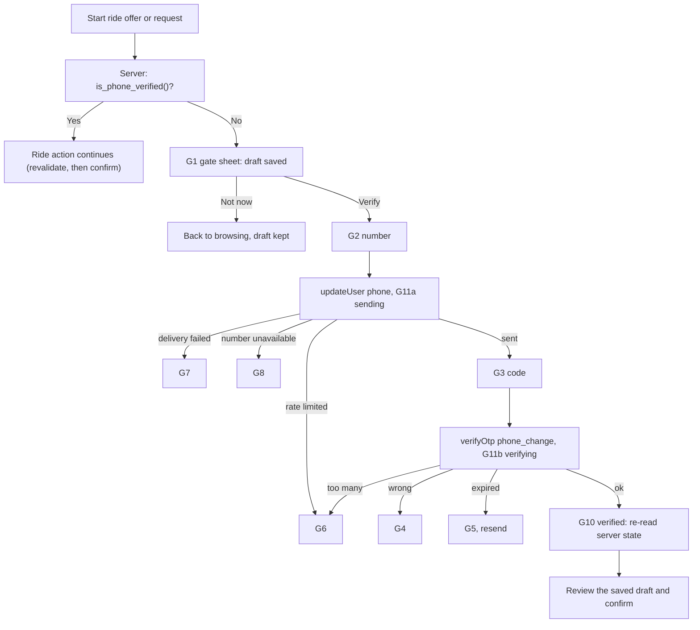

# TAW-5 Deferred phone verification: design spec (criteria revision 3)

Authoring card: TAW-5 authoring card (scope revision 1). Implementation card: TAW-5 (Critical lane), scope revision 3, AC1 to AC12. Author: Claude. Companion: `2026-10-26-TAW-5-provider-adr.md` (provider and flow decision, evidence quality, verification items V1 to V6). Approved design: Figma file `2j3vO1USLBA8XiRpQKCF3H`, section `214:1809` (design card DONE, 2026-10-26). Status: DRAFT for the spec gate; not approved; not authorization to implement.

Labels: **Fact** = verified in the repository or documented by the provider; **Reported** = relayed by the owner, not verified by the authoring session; **UNVERIFIED** = needs the verification register (section 11); **Proposal** = a recommendation that binds only after the owner approves it.

## 1. Purpose, decisions and boundaries

A signed-in user (Google; Apple later) may browse, complete onboarding and profile, and select a community without a phone. Before the **first ride offer or first ride request, whichever comes first**, the user must verify a phone number with a WhatsApp one-time code. After a successful verification the user stays verified unless an owner-approved security rule requires re-verification (section 9).

Decisions (owner, 2026-10-24 to 2026-10-26): WhatsApp is the only channel; the SMS fallback is deferred (separate PROPOSED card); no phone or OTP at sign-up; Sign in with Apple later; the provider is the owner's Supabase Send SMS hook to the WhatsApp Cloud API (ADR).

Boundaries (unchanged from TAW-7 and TAW-4):

| Owner | Responsibility |
|---|---|
| TAW-7 (DONE) | Sign-in, session storage, session-loss rules, the `accounts` row and its RLS |
| TAW-4 (DONE) | Profile, consent, car data, `can_request_rides()` and `can_post_rides()` (not changed here) |
| **TAW-5** | Phone verification, the server-side phone gate, draft resume, duplicate-phone handling, OTP abuse controls, the `send-otp-hook` function under version control |
| Later cards | Logout, account deletion, SMS fallback, Android sign-in, Sign in with Apple, the ride features themselves |

**Out of scope:** payments, fares, quotas; SMS delivery; phone number change UI (none exists); sharing a phone number with another user (ride features); production WhatsApp onboarding steps (Egypt rates, sender approval).

## 2. Flow

1. The ride feature calls the client hook `usePhoneGate().requireVerified(pending)` before it starts a publish or a request. The hook reads `is_phone_verified()` from the server (never a local flag). If true it returns `proceed`.
2. If false it saves the pending action (section 7) and shows the gate sheet (G1a first offer, G1b first request). "Not now" returns to browsing with the draft kept.
3. Number entry (G2, default country EG +20, E.164 built on the client and validated again on the server) starts verification: `supabase.auth.updateUser({ phone })` and the code is delivered by the hook (ADR). UI states follow the error mapping in section 6.
4. Code entry (G3) calls `supabase.auth.verifyOtp({ phone, token, type: 'phone_change' })`. On success the app does not trust the call result: it re-reads `is_phone_verified()` (the database trigger, section 4, is the authority) and only then shows G10.
5. G10 returns to the saved draft. The action is **never submitted automatically**: the user reviews and confirms again ("Review and confirm"), after the app has re-checked profile completion and the TAW-4 eligibility (`can_post_rides()` or `can_request_rides()`) because time has passed.
6. A user who is already verified never sees the gate again (AC3).

**Binding of the code to the user and session (AC4).** The phone-change flow runs only with an authenticated session: `updateUser` and `verifyOtp` (type `phone_change`) carry the signed-in user's access token and the pending number is attached to that user's auth record, so a code issued for one user cannot verify a number for another (**UNVERIFIED**, V1 and V7). Supabase ties the code to the user, not to a device session (**UNVERIFIED**, V7), so this spec proposes the following reading of AC4: the code is bound to the current user and is valid only while that user has an active session; the client discards a pending verification on sign-out and on session loss (section 7). If the owner requires per-session binding, the ADR's fallback (a project-owned OTP service) is needed (O9). Tests: another user's session, no session, after sign-out, a second session of the same user (outcome recorded as observed), expired and replayed codes.

Browse, onboarding, profile and community selection never call the gate (AC2).

## 3. Data model

No new columns on `accounts` (TAW-7 already has `phone_e164`, `phone_verified`, the check "verified requires a phone", the partial unique index on verified numbers, select-own RLS and no client write grants). **Fact** (migration 20261024204100).

New objects (one migration):

| Object | Purpose |
|---|---|
| `public.is_phone_verified()` | `stable security definer`, returns the caller's `accounts.phone_verified`; false when the row is missing; never raises; execute for `authenticated` |
| `public.require_phone_verified()` | raises `phone_unverified` (same `raise exception '<code>'` style as TAW-4) when not verified; for use inside ride RPCs and for tests; execute for `authenticated` |
| `public.on_auth_phone_confirmed()` + trigger on `auth.users` | trusted setter (section 4) |
| `public.phone_send_log` | one row per OTP send reservation: `webhook_id` (unique, the standard-webhooks id), `user_id`, `phone_hash` (SHA-256 with a server-side pepper, never the number), `reserved_at`, `outcome` (`reserved`, `sent`, `failed`); RLS enabled; no table privileges for `anon`, `authenticated` or `service_role` (access only through the two functions below) |
| `public.reserve_phone_send(webhook_id, user_id, phone_hash)` and `public.finish_phone_send(webhook_id, outcome)` | the atomic limiter (section 5); `security definer`; execute for `service_role` only |
| `public.phone_verification_audit` | one row per change of `phone_verified`: `user_id`, `changed_at`, `old_verified`, `new_verified`, `cause` (`otp_confirmed`, `number_changed`, `confirmation_cleared`, `operator_revoke`); never stores the number; written only by the trigger path and `revoke_phone_verification`; no API role can read or write it |
| `public.purge_phone_logs()` | deletes `phone_send_log` and audit rows older than 30 days; owner-only, run by a scheduled database job |

Ride features must call `require_phone_verified()` inside their own security-definer RPCs, or use `is_phone_verified()` in RLS policies, **in addition to** TAW-4's `can_*` functions. TAW-5 does not change TAW-4's functions. Because no ride action exists yet (**Fact**, discovery 2026-10-26), TAW-5 proves the gate with a pgTAP-only fixture function that calls `require_phone_verified()`, and records the call-site rule for the ride cards.

## 4. Trusted setter and invalidation (AC4, AC1, AC6, AC8)

One trigger function (`security definer`, `search_path = ''`, owned like the TAW-7 trigger) runs `after update of phone, phone_confirmed_at on auth.users`, with two separate paths in this order:

1. **Invalidation (trust removed).** When `new.phone is distinct from old.phone`, or `new.phone_confirmed_at is null`, or `new.phone is null`: set `accounts.phone_verified = false` and `phone_e164 = null` for `user_id = new.id`, and write an audit row (`number_changed` or `confirmation_cleared`).
2. **Verification (a new confirmation event).** Only when `new.phone is not null and new.phone_confirmed_at is not null and new.phone_confirmed_at is distinct from old.phone_confirmed_at`: set `phone_e164` to the E.164 form of `new.phone` and `phone_verified = true`, and write an audit row (`otp_confirmed`). A retained non-null timestamp or a number change without a new confirmation never verifies.

A statement that changes the number and the confirmation together (the normal `phone_change` confirmation) runs path 1 then path 2 and ends verified for the new number.

**Collisions (AC6).** The partial unique index on verified numbers makes a second verification of the same number fail; the whole `auth.users` statement then rolls back, including the invalidation. Outcomes: an account that was **unverified** stays unverified; an account that was **verified with another number** keeps that number and its verified state (nothing commits), and the user sees G8 either way, with no field naming the other account. Two concurrent confirmations of the same number are serialized by the index: exactly one commits, the other fails as above (test with two connections). Whether the provider's code remains usable after the rollback is **UNVERIFIED** (V3).

**Who can write the inputs.** `anon`, `authenticated` and `service_role` have no write privilege on `auth.users` (**UNVERIFIED**: V8 reads the actual grants on the local stack and the hosted project; the pgTAP test asserts them). The Supabase Admin API with the service-role key can confirm a phone without an OTP (`phone_confirm`); that is a trusted operator path with the same trust as the key. The app, the hook and the repository never call it (a repository scan is part of the gates), and every resulting change of `phone_verified` is visible in the audit table.

**Direct writes to `accounts`.** The existing TAW-7 migration revokes write privileges from `public`, `anon` and `authenticated` only; it does not mention `service_role`, and the TAW-4 repair covers only profile and verification tables (**Fact**, read 2026-10-26). **New required TAW-5 work:** `revoke all on public.accounts from service_role` and `grant select` back, with denial tests for insert, update, delete and truncate as `service_role` (including forged claims) and a mutation check (section 15).

**UNVERIFIED (V2):** the exact `auth.users` behaviour (columns changed by `phone_change`, the stored number format with or without the plus, when `phone_confirmed_at` is set). The migration normalizes with one function and a test per observed form. **Alternative if V2 shows the trigger is not viable:** the same state change through a security-definer function called by an Edge Function with the service role after it has verified the code state; the owner decides before the plan is approved.

## 5. The `send-otp-hook` function (AC5, AC8, AC11)

Moved into `supabase/functions/send-otp-hook/` (**Reported:** it exists today only on the hosted project; its current code is UNVERIFIED, V6). Contract (**Fact** from the Supabase Send SMS hook documentation: payload `user` with `user.phone` and `sms.otp`, six digits; signature verified with the `standardwebhooks` library and the hook secret; an empty 200 is success):

1. Verify the standard-webhooks signature on the raw body before parsing; reject (non-200) on any failure.
2. **Reserve before sending, atomically.** Call `reserve_phone_send(webhook_id, user_id, phone_hash)`, which in one transaction takes advisory locks for the user and for the phone hash (always in the same order, so no deadlock), counts the reservations in the window for the user, the phone and the whole project, and inserts a `reserved` row only if all three limits hold. It returns `ok`, `rate_limited` or `duplicate`. `webhook_id` is the standard-webhooks id header: a signed retry of the same webhook returns `duplicate` and the hook answers 200 without sending a second message. A rejected reservation returns a non-200 with a fixed body naming only the category (`rate_limited`), never the number or the code. After the provider call the hook records `sent` or `failed` with `finish_phone_send`; failed sends still count toward the limits (cost abuse). If the limiter or its storage is unavailable the hook **fails closed**: non-200 `delivery_failed`, nothing sent.
3. Send the template `tawsila_otp` through the WhatsApp Cloud API with the OTP; on a provider rejection return a non-200 fixed body (`delivery_failed`).
4. Never log the OTP, the full number or the access token. Logs may carry the outcome category, a hash prefix and a request id.
5. Secrets come only from environment variables: `SEND_SMS_HOOK_SECRET`, `WHATSAPP_ACCESS_TOKEN`, `WHATSAPP_PHONE_NUMBER_ID`, `PHONE_HASH_PEPPER`. The repository holds only `.env.example` with names and no values; local and test runs use a sandbox stub of the WhatsApp API (no real send).
6. Meta delivery webhooks, if enabled later, update a status column only and never `phone_verified`.

## 6. Limits, errors and abuse controls (AC4, AC5)

**Proposal (values the owner approves with the approval line; configurable, not hard-coded in the UI):**

| Control | Value | Enforced by |
|---|---|---|
| Code length | 6 digits | Supabase (fact) |
| Code validity | 10 minutes, single use | Supabase settings, UNVERIFIED (V4: the docs page also mentions a 60-second window) |
| Resend interval | at least 60 seconds | Supabase `max_frequency`, plus the hook |
| Sends per user | 5 per 24 hours | hook, `phone_send_log` |
| Sends per phone number | 5 per 24 hours (all users) | hook, `phone_send_log` by `phone_hash` |
| Failed code attempts | 5 wrong codes per issued code, then the code is dead and a new one must be requested (which counts toward the 5 sends per 24 hours); a locked-out user sees G6 | Supabase verification behaviour and rate limits, UNVERIFIED (V5); if Supabase cannot enforce this, the owner chooses between accepting the provider's limits and the ADR fallback (O9) |
| Sends per hour, project-wide | 200 across all users (sized for the MVP; the owner sets the final figure); at the cap every user sees the G6 "try later" state and recovery is automatic when the window rolls over | hook limiter (section 5), plus the Supabase project rate limits as a second layer |

Error mapping (client): every provider error becomes one UI state; an unknown error becomes the generic failure (G7 when sending, G4 when verifying), never a raw message. Mapping table (final codes UNVERIFIED, V3 and V5):

| Condition | UI state |
|---|---|
| Hook non-200 `delivery_failed`, network error while sending | G7 (retry, no SMS) |
| Hook non-200 `rate_limited`, Supabase rate-limit error | G6 |
| Number already verified by another account (V3) | G8, wording does not say why |
| Wrong code | G4 |
| Expired or used code | G5 |
| Offline | G9 |

## 7. App structure and draft resume (AC3, AC7)

New feature folder `apps/mobile/src/features/phoneVerification/`: a state machine (`idle`, `gate`, `number`, `sending`, `code`, `verifying`, `verified`, `error:<kind>`), the API wrapper around `updateUser`, `verifyOtp` and the RPCs, the `usePhoneGate()` hook, and screens built only from the approved frames (G1a to G11b, light and dark; strings in `strings.ts`).

- **Pending draft reference, not content:** TAW-5 keeps only a reference `{ kind (offer or request), draftId, userId }` in memory. The ride feature owns persisting its draft content (it alone knows the fields) and follows the TAW-7 fresh-install rule; TAW-5 persists nothing about the draft, so no new storage dependency and no change to the auth files is needed. Keychain-backed stores survive an iOS reinstall, which is why TAW-5 does not use one for drafts.
- **Identity checks (TAW-7 rules unchanged):** the state machine captures the user id and the AuthProvider session identity when it starts and compares them before every asynchronous state update, before showing G10 and before returning a draft reference. A mismatch (sign-out, account switch, session loss, a stale callback) discards the flow silently, clears the reference and returns to the TAW-7 routing state.
- **Revalidation after verification:** the hook returns the draft only after a fresh server read of `is_phone_verified()`, profile completion and the TAW-4 eligibility; if any check fails the user is routed to the matching step (for example profile) with the draft kept.
- **Fresh confirmation:** the ride feature shows its own review screen and requires a user action; TAW-5 never publishes or sends.
- The OTP and the number live only in component state and are cleared when the flow ends or the app backgrounds beyond the code validity.
- Android: the code is cross-platform and checked by the Android bundle build; Android delivery is **BLOCKED** until an Android sign-in card exists (TAW-7 is iOS only). Any reduction of TAW-5 to iOS only needs the owner's approval.

## 8. Privacy and security

- The verified number is readable only by its owner (existing RLS); no other user or public profile exposes it; the verified badge on a profile (Figma 23:768) shows only a boolean and is built by the profile feature, not here.
- Provider access tokens and the hook secret never enter the repository, logs or analytics; `.env` files are git-ignored (TAW-7 hygiene) and a secrets scan is part of the gates.
- Phone numbers are personal data: the Egypt data-protection check stays an open prerequisite before real users are verified (owner-deferred, not done here).
- `phone_send_log` stores a salted hash, not the number, and is purged after 30 days (Proposal).
- Phone sign-ups stay Off on every environment (ADR decision 4); a test or runbook step checks that the phone sign-in endpoint creates no user.

## 9. Re-verification (AC8)

Rule 0 (technical, no owner approval needed because it removes trust): a verified state never outlives the number it was verified for (section 4).

**Proposals, not binding until the owner approves each one:**

| ID | Rule | Notes |
|---|---|---|
| R1 | An operator can clear `phone_verified` through a service-role function `revoke_phone_verification(user_id, reason)`; no app UI | for abuse or number recycling reports; audit row required |
| R2 | No automatic expiry of verification | matches "remain verified" |

Anything else (periodic re-verification, risk signals, device change) is a separate PROPOSED card. No screens exist for re-verification (design card).

## 10. Tests and evidence

1. **pgTAP (local stack):** the trigger sets `phone_verified` only on a confirmed phone; an unconfirmed `updateUser` never verifies; a different number resets verification; a duplicate verified number fails and leaves the account unverified with no information about the other account; `is_phone_verified()` and `require_phone_verified()` for verified, unverified and missing-row cases; the fixture ride function is blocked until verified; clients cannot write `phone_verified` or call the trigger; the trigger invalidation and verification paths for a cleared confirmation, a replaced unconfirmed number, a retained timestamp and a new confirmation event; collision outcomes for an initially verified and an initially unverified account, with rollback and two concurrent connections claiming one number; `anon`, `authenticated` and `service_role` cannot write `auth.users` or `accounts`; the limiter under concurrency (N parallel reservations at the boundary allow exactly the limit), a duplicate `webhook_id`, project-cap exhaustion and a storage failure that fails closed; the audit rows; the whole role matrix of section 15 with its mutation checks.
2. **Hook tests (sandbox stub, no real send):** invalid or missing signature rejected; the OTP, number and token never appear in logs or responses; per-user and per-phone limits; provider rejection returns `delivery_failed`; secrets absent from the repository.
3. **Jest (app):** the state machine for every state and transition including a second tap and a back-press; the error mapping; the gate allows browse, onboarding, profile and community selection without verification and blocks only the two ride actions; the draft is saved, kept on "Not now", restored after verification with a fresh confirmation, cleared on sign-out; no OTP or number is persisted; offline handling; account switching, session loss during verification, stale callbacks and a user change clearing the draft reference.
4. **Integration (only where prerequisites exist, owner-authorized):** V1 to V6 on the hosted test project with the owner's own number. A missing prerequisite makes the criterion BLOCKED, never PASSED (TAW-7 rule).
5. **Design fidelity:** iOS Simulator screenshots of G1 to G11 light and dark against section 214:1809; physical-iPhone and Android evidence are owner-run or blocked as stated.

## 11. Verification register (each becomes a plan step; UNVERIFIED until run)

| ID | Question | Needs |
|---|---|---|
| V1 | With phone sign-ups Off, does `updateUser({ phone })` for a signed-in Google user send through the hook and complete with `verifyOtp` type `phone_change`? | hosted test project, owner number |
| V2 | Which `auth.users` columns change, in which format, and what does the hook payload contain for this flow? | same |
| V3 | What error is returned when the number belongs to another user; can it map to G8 without disclosure? | a second test identity |
| V4 | The effective code validity and resend limit; can they be set to section 6? | settings access |
| V5 | Error codes for wrong, expired and repeated attempts | same |
| V6 | The current hook code: signature check, logging, failure responses | the function source |
| V7 | Can a code issued for user A be confirmed by user B, with no session, or from a second session of A? | two test identities |
| V8 | The real privileges of `anon`, `authenticated` and `service_role` on `auth.users` (local and hosted) | database access |

## 12. Owner decisions and open items

| ID | Item | Status |
|---|---|---|
| O1 | Approve R1 and R2, or none (section 9) | open |
| O2 | Approve the limits in section 6 or change them | open |
| O3 | Authorize the V1 to V6 spike on tawsila-dev (external action, a few WhatsApp messages to the owner's number) | open ("spike later") |
| O4 | Turn "Allow new users to sign up" Off for the Phone provider on tawsila-dev | open, owner action |
| O5 | Android: keep in scope but BLOCKED, or reduce to iOS only | open |
| O6 | Create the SMS-fallback card as PROPOSED | open |
| O7 | Egypt data-protection check and the full production prerequisite list of AC12, each recorded done with evidence before phone-gated ride functions are enabled in production: WhatsApp Business API onboarding, template approval (**Reported** approved, not verified), Egypt rates, sender approval and abuse controls (section 6); the SMS fallback cost is not applicable while the fallback is deferred | deferred by the owner |
| O9 | AC4 session binding: accept "bound to the user and valid only with an active session" (section 2) or require per-session binding, which needs the ADR fallback | open |
| O8 | Arabic copy and RTL for the new screens | open, not designed |

## 13. Allowed paths proposed for TAW-5 (fixed in the plan)

`supabase/migrations/` (one new file), `supabase/functions/send-otp-hook/`, `supabase/tests/database/` and a hook test location chosen in the plan, `supabase/config.toml` (local sandbox settings only), `apps/mobile/src/features/phoneVerification/`, `apps/mobile/src/app/` (the gate route only), `apps/mobile/src/strings.ts`, `apps/mobile/src/__tests__/phoneVerification/`, `.env.example`, `.gitignore`, `README.md`. Never `docs/superpowers/`.

## 14. Criteria coverage (TAW-5 revision 3)

| Criterion | Where |
|---|---|
| AC1 attach to the TAW-7 row, no session, no phone at sign-up | 2, 3, 4 |
| AC2 browse, onboarding, profile, community ungated | 2, 7, 10 |
| AC3 first offer or first request, draft resume, fresh confirmation, no re-gating | 2, 7 |
| AC4 only a successful OTP validation sets `phone_verified`, via trusted code; bound to the user and session | 2, 4, 6, 7, 10, 11 |
| AC5 expiry, resend throttling, abuse controls | 5, 6, 10, 11 |
| AC6 duplicate phone never assigned or disclosed | 4, 6, 10 |
| AC7 server-side authorization, tests for allowed and blocked actions | 3, 10 |
| AC8 verified stays verified; owner-approved re-verification | 9 |
| AC9 WhatsApp only; failure state without SMS | 1, 5, 6 |
| AC10 ownership split with TAW-7 | 1 |
| AC11 no secrets committed; sandbox config; ADR | 5, 8, ADR |
| AC12 no payments or fare disputes; production prerequisites recorded | 1, 12 |

## 15. Least-privilege check (new tables and privileged functions)

For every object: who can read and write, which grants are revoked, a bypass test as every role that could bypass the guarded decision, and a mutation check (add the forbidden grant; the named assertions must fail). Privilege assertions use `has_table_privilege` and `has_function_privilege` for each of `public`, `anon`, `authenticated`, `service_role` so that an added grant is caught even when the call path would not work (a trigger function is not callable as an ordinary function, so the assertion is on the privilege and on the trigger path).

| Object | anon | authenticated | service_role | Grants revoked | Bypass tests | Mutation check |
|---|---|---|---|---|---|---|
| `accounts` (existing table; **new** service_role revoke) | none | select own row only | select only | all privileges from `service_role`, then select granted back | as each of the three roles: insert, update, delete, truncate of any column fail (including with forged `request.jwt.claims`); the only way `phone_verified` changes is the trigger path (section 4) | granting `update` or `insert` on `accounts` to `service_role` fails the denial assertions |
| trigger function (`on_auth_phone_change`) | no execute | no execute | no execute | execute from `public`, `anon`, `authenticated`, `service_role` | privilege assertion for all four roles; the trigger-path tests of section 10 | granting execute to any role fails the privilege assertion |
| `is_phone_verified()`, `require_phone_verified()` | no execute | execute (own row, no user argument) | no execute | execute from `public`, `anon`, `service_role` | `anon` and `service_role` calls are denied, including with a forged `sub`; an unverified `authenticated` user gets `phone_unverified` and a verified one passes; no argument can name another user | granting execute to `anon` or `service_role` fails the assertions |
| `phone_send_log` | none | none | none (functions only) | all table privileges from `public`, `anon`, `authenticated`, `service_role` | as each role: select, insert, update, delete, truncate denied; history cannot be rewritten to reset a limit | granting any table privilege to any role fails the denial assertions |
| `reserve_phone_send()`, `finish_phone_send()` | no execute | no execute | execute | execute from `public`, `anon`, `authenticated` | `anon` and `authenticated` denied; `service_role` can only reserve and finish, cannot read, edit or delete rows; a repeated `webhook_id` creates no second row | granting execute to `authenticated` fails the assertions |
| `phone_verification_audit` | none | none | none | all table privileges from `public`, `anon`, `authenticated`, `service_role` | as each role: select, insert, update, delete, truncate denied; rows appear only through the trigger path and `revoke_phone_verification` | granting any table privilege fails the denial assertions |
| `revoke_phone_verification(user_id, reason)` (only if the owner approves R1) | no execute | no execute | execute | execute from `public`, `anon`, `authenticated` | each non-service role denied; the function can only set `phone_verified` to false and writes an audit row; it cannot verify | granting execute to `authenticated` fails the assertions |
| `purge_phone_logs()` | no execute | no execute | no execute | execute from `public`, `anon`, `authenticated`, `service_role` | privilege assertion for the four roles; a boundary test shows only rows older than 30 days are deleted | granting execute to any role fails the privilege assertion |

These rows feed the plan's least-privilege check and are verified against the diff and the test evidence at review.

